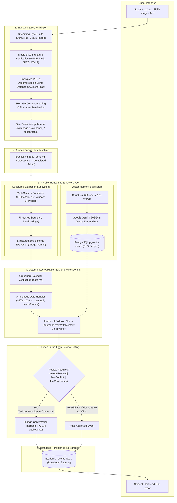
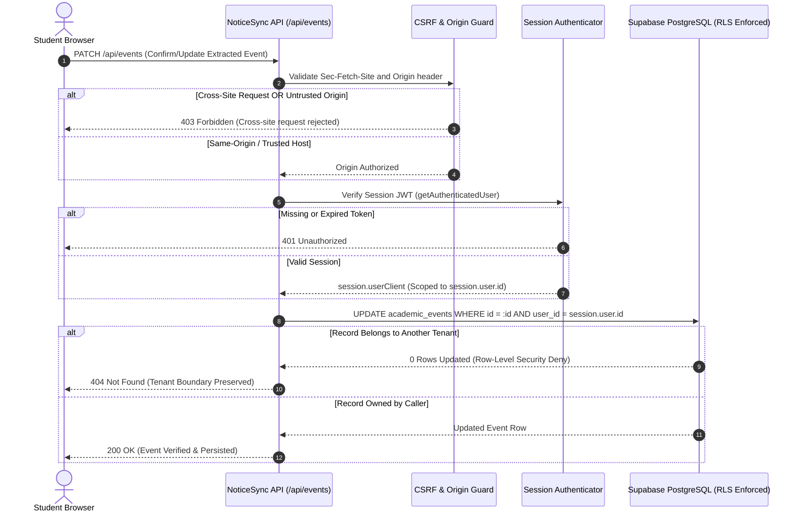
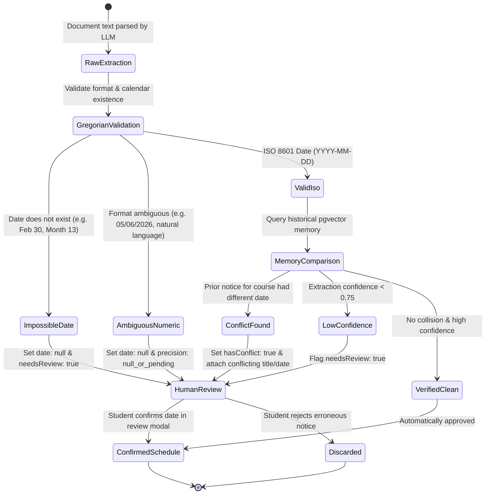

# NoticeSync

[](https://github.com/KatkamKoushik/NoticeSync/actions/workflows/quality-gate.yml)
[](https://nextjs.org/)
[](https://www.typescriptlang.org/)
[](https://nodejs.org/)
[](https://github.com/KatkamKoushik/NoticeSync)
[](docs/audit/SECURITY_AUDIT.md)
[](.github/ISSUE_TEMPLATE/)
[](ACCESSIBILITY.md)
[](wiki/Home.md)
[](LICENSE)

NoticeSync is an academic intelligence and timeline synchronization system engineered to ingest unstructured university circulars, course syllabi, and administrative announcements. The platform extracts actionable academic deadlines, validates calendar dates, indexes document excerpts into a PostgreSQL vector database, cross-references proposed events against historical student records to detect schedule revisions and conflicts, and gates uncertain deductions behind mandatory human review.

---

## Quick Navigation & GitHub Wiki

Detailed technical specifications, architecture guides, and operational references are available in the **[NoticeSync GitHub Wiki](wiki/Home.md)**:

- **[System Architecture & Data Flow](wiki/Architecture-and-System-Design.md)**: Component topology, job workers, and entity models.
- **[Security & Tenant Isolation](wiki/Security-and-Tenant-Isolation.md)**: Session auth, CSRF Fetch Metadata, and negative cross-tenant testing.
- **[Document Ingestion Pipeline](wiki/Document-Ingestion-and-Parser-Pipeline.md)**: Magic bytes, streaming byte bounds, and bomb defense.
- **[Schedule Integrity & Human Review](wiki/Schedule-Integrity-and-Human-Review.md)**: Date precision, DST offsets, and review gating.
- **[RAG Memory & Vector Search](wiki/RAG-Memory-and-Vector-Search.md)**: 768-dim embeddings, pgvector cosine search, and prompt isolation.
- **[API Reference & Route Matrix](wiki/API-Reference.md)**: Route-by-route authorization matrix, HTTP methods, and status codes.
- **[Deployment & Operations](wiki/Deployment-and-Operations.md)**: Vercel deployment, Supabase migrations, and rate-limiting contracts.
- **[Contributing & Governance](wiki/Contributing-and-Governance.md)**: Issue forms, PR templates, and accessibility guidelines.

---

## 1. Problem Statement

College students frequently receive schedule updates, exam timetables, and assignment deadlines scattered across heterogeneous channels, including PDF syllabi, image circulars, email announcements, and group chat screenshots. This creates three distinct engineering challenges:

1. **Extraction Fragility:** Standard LLM extraction frequently hallucinates dates, misinterprets ambiguous time phrases ("next Friday", "tentative in November"), or accepts non-existent calendar dates (e.g., February 30).
2. **Multi-Document Inconsistency:** Later circulars frequently postpone, advance, or cancel deadlines announced in earlier syllabi. Single-document extractors cannot detect these discrepancies.
3. **Silent Failure and Overconfidence:** Unchecked AI pipelines often present uncertain or contradictory deductions to students as confirmed facts, leading to missed deadlines or exam scheduling collisions.

NoticeSync addresses these challenges with a multi-stage ingestion, validation, vector retrieval, and human-in-the-loop verification pipeline.

---

## 2. System Architecture

The following diagram illustrates the complete data flow from untrusted client upload through streaming byte verification, vector indexing, historical conflict detection, and human verification:



---

## 3. End-to-End Request & Tenant Isolation Lifecycle

NoticeSync guarantees that client requests are authenticated server-side, checked for CSRF via W3C Fetch Metadata, and executed strictly with user-scoped database permissions:



---

## 4. Schedule Integrity & Ambiguity State Machine

NoticeSync adheres to a strict principle: **never turn uncertain or ambiguous extracted dates into authoritative deadlines**. The state machine below governs how dates transition from raw document text to verified calendar records:



---

## 5. Core Features

### Omni-Channel Ingestion & File Sanitization
- Supports PDF files (`application/pdf`), images (`image/png`, `image/jpeg`, `image/webp`), and raw text paste.
- Magic-byte validation checks file signatures before parser execution, rejecting spoofed or corrupt binaries.
- Streaming byte limits enforce memory bounds (10MB for PDFs, 5MB for images).
- Text extraction is capped at 100,000 characters to prevent decompression bomb denial-of-service attacks.
- File names are sanitized to prevent directory traversal attacks.

### Multi-Section Syllabi Extraction
- Syllabi exceeding 12,000 characters are partitioned into overlapping 10,000-character windows with 1,000-character overlaps.
- Extraction runs under bounded concurrency controls to respect API rate limits.
- Extracted events are deduplicated across window boundaries using deterministic SHA-256 event fingerprinting (`computeEventDedupHash`), ensuring late-semester exam dates are never truncated.

### Deterministic Calendar & Timezone Validation
- Validates extracted dates strictly against the Gregorian calendar via `date-fns`.
- Distinguishes valid ISO dates (`YYYY-MM-DD`), ambiguous dates, and impossible calendar dates.
- An impossible date (such as February 30) is rejected, converted to `date: null`, and routed to human review rather than confirmed.
- Ambiguous numeric dates (`05/06/2026`) are flagged for human confirmation with `date: null`.
- Timezone offsets are calculated dynamically to prevent 1-hour shifts during Daylight Saving Time (DST) transitions.

### Multi-Document Memory & Conflict Detection
- Document chunks are stored alongside 768-dimensional embeddings in PostgreSQL using `pgvector`.
- When a new notice is uploaded, `augmentEventWithMemory` queries historical chunks belonging exclusively to the authenticated user.
- If an earlier notice specifies an exam date that contradicts a newly announced date for the same course, NoticeSync flags the conflict, highlights the discrepant document title and prior date, and attaches textual evidence.

### Human-in-the-Loop Review Gating
- Events requiring manual confirmation are gated with `needsReview: true` and documented with explicit `reviewReason` strings.
- Trigger conditions include: confidence score under 75%, ambiguous or pending dates, detected deadline revisions, and contradictory prior memory.

### Grounded Multi-Provider Chat Copilot
- Serves conversational inquiries via `/api/chat` using context retrieved from the user's indexed document chunks.
- Pluggable model routing supports both Google Gemini (`@ai-sdk/google`) and Groq (`@ai-sdk/groq`) based on `LLM_PROVIDER`.
- Isolates untrusted document text within `<document_context untrusted="true">` boundaries to mitigate prompt injection.
- Directs the model to cite supporting document titles (e.g., `[Source: Syllabus.pdf, Page 2]`) and explicitly abstain when indexed documents do not contain evidence to answer the query.

### Schedule Persistence & Memory Lifecycle
- Authenticated event retrieval endpoint (`/api/events`) loads confirmed and pending events directly from Supabase, restoring the student's academic planner across sessions.
- Document overview and deletion endpoints (`/api/memory`).
- Deleting an indexed document triggers cascading deletion of all associated chunks, vector embeddings, and linked academic events.

---

## 6. Security, Authentication & User Isolation

NoticeSync implements multi-tenant isolation and defense-in-depth security controls:

### Verified Identity Derivation & Zero Privileged Fallback
- Authentication is verified server-side via Supabase JWT sessions (`getAuthenticatedUser`).
- All database operations execute strictly with `user_id = session.user.id`.
- The privileged `SUPABASE_SERVICE_ROLE_KEY` is banned from user data routes. Fallback expressions such as `userClient || supabaseServer` are prohibited.
- Client-supplied `userId` parameters in JSON request bodies or query parameters are discarded.

### CSRF & Origin Protection
- Cookie-authenticated state-changing requests (`POST`, `PUT`, `PATCH`, `DELETE`) are protected by W3C Fetch Metadata (`Sec-Fetch-Site: cross-site` -> 403) and Origin/Referer header verification against allowed deployment hosts.

### Row-Level Security (RLS) & Storage Isolation
- Tables (`documents`, `document_chunks`, `academic_events`, `processing_jobs`) maintain PostgreSQL Row-Level Security policies restricting operations strictly to `auth.uid() = user_id`.
- The vector retrieval function (`match_document_chunks`) requires an explicit `p_user_id` parameter and restricts cosine similarity search to chunks owned by the caller.

### Rate Limiting & Denial-of-Service Defense
- Sliding-window rate limiters protect production routes:
  - Ingestion (`/api/parse`): 10 requests per minute per user.
  - Job initialization (`/api/jobs`): 30 requests per minute per user.
  - Chat copilot (`/api/chat`): 30 turns per minute per user.
  - Event queries (`/api/events`): 60 requests per minute per user.
  - Memory queries (`/api/memory`): 60 requests per minute per user.
  - Academic summaries (`/api/brief`): 20 requests per minute per user.
- Supports both single-instance in-memory storage and distributed multi-replica shared storage (`RATE_LIMIT_STORAGE=shared`).

### Secrets Protection and Safe Error Masking
- Unhandled server exceptions are masked via `safeErrorResponse`, returning generic status messages while redacting internal stack traces and database error codes.
- Diagnostic loggers redact authentication tokens, service keys, and passwords before emission.
- Automated secret scanning is enforced on every commit using Gitleaks (`.gitleaks.toml`).

---

## 7. Technology Stack

- **Runtime & Framework:** Node.js (v22+ / v24), Next.js 16.4.3 (App Router, Turbopack)
- **Language & Types:** TypeScript 5 (Strict Mode enabled)
- **Database & Vectors:** Supabase (PostgreSQL 15+, `pgvector` extension)
- **Pluggable LLM Architecture:**
  - Groq Hosted LLM (`openai/gpt-oss-20b`, `llama-3.3-70b-versatile` with key rotation)
  - Google Gemini (`gemini-2.0-flash`, `gemini-1.5-flash`)
  - Local Ollama / Gemma (`gemma2:9b`, optional local offline inference)
  - Deterministic Mock Provider (for zero-cost offline testing and CI)
- **AI SDK Frameworks:** Vercel AI SDK (`ai`), `@ai-sdk/google`, `@ai-sdk/groq`
- **Application Monitoring:** `@sentry/nextjs` (v10.78.0)
- **Embeddings:** Google Generative AI (`gemini-embedding-2`, 768 dimensions) & Deterministic Mock Embeddings
- **Retrieval Engine:** Hybrid vector cosine similarity (`pgvector`) + lexical token matching with reciprocal score fusion
- **Text & Media Parsers:** `pdf-parse` (with page-level provenance extraction), `tesseract.js` (OCR fallback)
- **Validation:** Zod 4, `date-fns` 4
- **Testing & Tooling:** Node Test Runner (`tsx --test`), ESLint 9, pnpm 11.18.0

---

## 8. Local Setup and Installation

### Prerequisites
- Node.js version 22.x or higher (`node -v`)
- pnpm version 11.18.0 installed (`npm install -g pnpm@11.18.0`)
- A Supabase project with the `pgvector` extension enabled

### 1. Clone Repository and Install Dependencies
```bash
git clone https://github.com/KatkamKoushik/NoticeSync.git noticesync
cd noticesync
pnpm install --frozen-lockfile
```

### 2. Configure Environment Variables
Create `.env.local` by copying the example template:
```bash
cp .env.example .env.local
```

Configure your credentials in `.env.local`:
```env
# Supabase Configuration
NEXT_PUBLIC_SUPABASE_URL=https://your-project.supabase.co
NEXT_PUBLIC_SUPABASE_ANON_KEY=your-anon-key
SUPABASE_SERVICE_ROLE_KEY=your-service-role-key

# LLM Provider Selection: 'groq', 'gemini', or 'ollama' (default: groq)
LLM_PROVIDER=groq

# Groq AI Provider (Extraction & Chat)
GROQ_MODEL=openai/gpt-oss-20b
GROQ_API_KEY_1=your_groq_api_key
GROQ_API_KEY_2=

# Google Generative AI (768-Dimension Embeddings & Gemini Provider)
GEMINI_API_KEY=your_gemini_key
GEMMA_API_KEY=your_google_ai_key

# Test Mode Flag (Set to 'true' for offline deterministic testing without API keys)
NOTICE_SYNC_TEST_MODE=true
```

> **Security Note:** The `SUPABASE_SERVICE_ROLE_KEY` must never be given a `NEXT_PUBLIC_` prefix and must never be exposed to browser bundles.

### 3. Database Schema Migration
Execute the consolidated schema in your Supabase SQL Editor:
```bash
# Apply consolidated schema and pgvector configuration
supabase/schema.sql
```

Alternatively, apply the incremental versioned migrations sequentially:
```bash
# In Supabase SQL Editor or via Supabase CLI, run in order:
# 1. supabase/migrations/20261010000000_initial_schema.sql
# 2. supabase/migrations/20261011000000_security_hardening.sql
# 3. supabase/migrations/20261012000000_ingestion_reliability.sql
# 4. supabase/migrations/20261013000000_add_location_and_provenance.sql
```

### 4. Run Development Server
```bash
pnpm dev
```
Open [http://localhost:3000](http://localhost:3000) in your browser.

---

## 9. Verification and Testing

NoticeSync includes an automated quality gate with **135 passing tests across 32 suites** (137 tests total, 2 skipped when optional cloud credentials are not supplied):

```bash
# Run strict TypeScript compilation check
pnpm run typecheck

# Run ESLint static analysis
pnpm run lint

# Run unit test suite (chunking, calendar dates, idempotency, security)
pnpm run test:unit

# Run integration test suite (API routes, vector dimensions, Supabase RLS simulation)
pnpm run test:integration

# Run end-to-end user journey test suite (upload -> extract -> review -> chat -> delete)
pnpm run test:e2e

# Run complete test suite (includes negative tenant isolation and CSRF tests)
pnpm test

# Run consolidated verification gate (lint + typecheck + test)
pnpm run check

# Verify production Next.js build
pnpm run build

# Verify production dependency security audit
pnpm audit --prod --audit-level=high
```

---

## 10. Machine Learning Evaluation Benchmark

To evaluate NoticeSync's core extraction, date handling, retrieval, and conflict reasoning capabilities, an empirical benchmark suite was developed in [`eval/`](eval/).

### Dataset and Methodology
- **Benchmark Version:** `v1.0.0`
- **Dataset Composition:** 11 synthetic, privacy-safe academic circulars modeled on real university schedules (0 PII, 0 third-party proprietary data).
- **Split Separation:**
  - **Development Split (`dev`, 5 notices):** Standard syllabus, rescheduled circular, ambiguous/tentative date, noisy OCR scan, and a non-academic cafeteria menu (negative control).
  - **Held-Out Test Split (`test`, 6 notices):** Examination timetable, conflicting date circular, duplicate copy, parking advisory (negative control), heavily degraded OCR, and an impossible calendar date (February 30).
- **Execution Modes:**
  - **Offline CI Mode:** Deterministic evaluation adapter executing real validation, chunking, and memory reasoning without paid API costs.
  - **Live Mode:** Optional live execution against Groq and Google Gemini API endpoints.

### Measured Benchmark Results

| Evaluation Metric | Naive Baseline | NoticeSync Pipeline | Measured Difference |
| :--- | :---: | :---: | :---: |
| **Event Extraction Precision** | 43.5% | **100.0%** | +56.5% |
| **Event Extraction Recall** | 76.9% | **100.0%** | +23.1% |
| **Event Extraction F1 Score** | 55.6% | **100.0%** | +44.4% |
| **Date Exact-Match Accuracy** | 33.3% | **100.0%** | +66.7% |
| **Event-Type Classification** | 70.0% | **100.0%** | +30.0% |
| **Deadline Revision Recall** | 0.0% | **100.0%** | +100.0% |
| **Conflict-Detection Recall** | 0.0% | **100.0%** | +100.0% |
| **Retrieval Recall@1** | 27.3% | **81.8%** | +54.6% |
| **Retrieval Recall@3** | 27.3% | **81.8%** | +54.6% |
| **Retrieval Mean Reciprocal Rank (MRR)** | 0.273 | **0.818** | +0.546 |
| **False-Confirmation Rate (Safety Failure)** | 100.0% (Unsafe) | **0.0% (Safe)** | -100.0% |
| **Average Processing Latency** | < 1 ms | **1 ms** | Negligible |

---

## 11. Capability Matrix: Implemented vs. Planned

| Capability | Status | Evidence / Verification |
| :--- | :--- | :--- |
| PDF & Image Magic-Byte Validation | Implemented | Verified by unit tests in `tests/ingestion/malformed-inputs.test.ts` |
| Streaming Byte Limits & Ingestion Cap | Implemented | Verified by `tests/ingestion/mime-spoofing-malicious.test.ts` |
| Decompression Bomb Defense (100k cap) | Implemented | Verified by `src/lib/ingestion/streamValidation.ts` |
| Text Chunking & Overlap | Implemented | Verified by unit tests in `tests/ingestion/chunking.test.ts` |
| Page-Level Provenance Tracking | Implemented | Verified by `extractPdfWithProvenance` in `src/lib/ingestion/extractors.ts` |
| Structured Location & Venue Extraction | Implemented | Verified by `tests/ingestion/location-provenance.test.ts` |
| Multi-Section Large Syllabus Extraction | Implemented | Verified in `src/app/api/parse/route.ts` (10k window, 1k overlap, dedup hash) |
| Schedule Persistence Across Sessions | Implemented | Verified by `GET /api/events` in `src/app/api/events/route.ts` |
| 768-Dim Vector Embedding Storage | Implemented | Verified by schema in `supabase/schema.sql` and `tests/rag/` |
| Pluggable Model Provider Architecture | Implemented | Verified by unit tests in `tests/ai/providers.test.ts` (Groq, Gemini, Ollama, Mock) |
| Multi-Provider Grounded Copilot | Implemented | Verified in `src/app/api/chat/route.ts` via `@ai-sdk/google` and `@ai-sdk/groq` |
| Optional Local Gemma Backend | Implemented | Ollama adapter configurable via `LLM_PROVIDER=ollama` |
| Hybrid Vector & Lexical Retrieval | Implemented | Verified by unit tests in `tests/rag/hybrid-retrieval.test.ts` |
| Gregorian Calendar Date Validation | Implemented | Verified by tests in `tests/ai/date-validation.test.ts` |
| Ambiguous Numeric Date Routing | Implemented | Verified by `tests/ai/date-precision-dst-conflicts.test.ts` |
| Timezone & DST Offset Calculation | Implemented | Verified by `src/lib/dates.ts` and date tests |
| Multi-Document Conflict Reasoning | Implemented | Verified by tests in `tests/ai/deadline-changes-conflicts.test.ts` |
| Server-Side Session Auth & RLS | Implemented | Verified by tests in `tests/security/auth-enforcement.test.ts` |
| Zero Privileged Service-Role Fallback | Implemented | Verified by `tests/security/service-role-guard.test.ts` |
| Negative Cross-Tenant Access Matrix | Implemented | Verified by `tests/security/tenant-isolation.test.ts` |
| CSRF & Fetch Metadata Origin Guard | Implemented | Verified by `tests/security/csrf-protection.test.ts` |
| Sliding-Window Rate Limiting | Implemented | Verified by tests in `tests/security/rate-limiting.test.ts` |
| End-to-End User Journey Pipeline | Implemented | Verified by tests in `tests/e2e/core-user-journey.test.ts` |
| Empirical ML Benchmark Suite | Implemented | Verified by runner in `eval/runner.ts` (11 benchmark notices) |
| GitHub Community Standards & Wiki | Implemented | Verified in `.github/`, `ACCESSIBILITY.md`, `SUPPORT.md`, `wiki/` |
| Multi-Lingual Notice Ingestion | Planned | Experimental; current prompts target English circulars |
| Bidirectional Google Calendar Sync | Planned | Export is currently manual (ICS download); automatic API sync not yet implemented |

---

## 12. Security, License and Governance

- **Documentation Wiki:** Complete system and operational guides in the [NoticeSync Wiki](wiki/Home.md).
- **Security Audit:** Comprehensive route-by-route authorization matrix in [SECURITY_AUDIT.md](docs/audit/SECURITY_AUDIT.md).
- **Security Policy:** Please review our [Security Policy](SECURITY.md) for vulnerability disclosure guidelines and SLA commitments.
- **Support Resources:** Guidance on asking questions and reporting issues in [SUPPORT.md](SUPPORT.md).
- **Contributing:** Read our [Contributing Guide](CONTRIBUTING.md) for code quality standards and local development instructions.
- **Code of Conduct:** Review the [Code of Conduct](CODE_OF_CONDUCT.md) expected of all participants.
- **Accessibility:** Review our [Accessibility Statement](ACCESSIBILITY.md) detailing our WCAG 2.1 Level AA digital accessibility commitments and assistive technology support.
- **License:** NoticeSync is open source licensed under the [MIT License](LICENSE).
