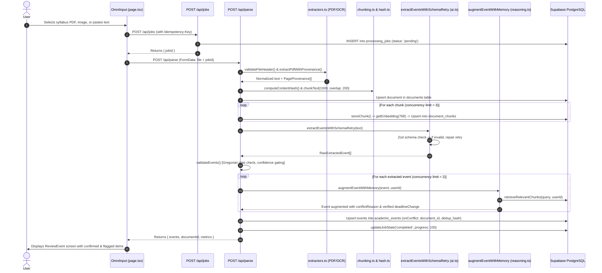
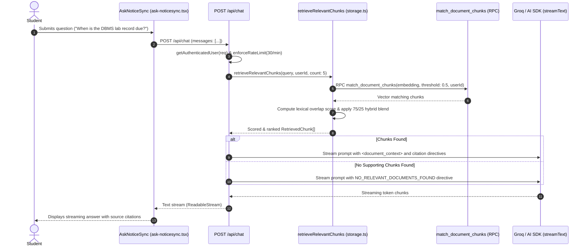

# NoticeSync — Architecture & System Design Review

**Target Repository:** [NoticeSync](https://github.com/KatkamKoushik/NoticeSync)  
**Audit Branch:** `audit/repository-review-and-roadmap`  
**Date:** October 31, 2026  

---

## 1. System Overview & Architecture

NoticeSync is structured as a full-stack Next.js application using the App Router, combining an interactive frontend with serverless API route handlers, backed by Supabase PostgreSQL (utilizing the `pgvector` extension for vector similarity search) and external LLM/embedding inference services.

### High-Level Architecture Diagram

```mermaid
graph TD
    subgraph Client ["Client Browser (Next.js Client Components)"]
        UI["App Shell (page.tsx)"]
        Omni["OmniInput (PDF/Image/Text)"]
        Review["ReviewEvent (Human Gating)"]
        PlannerView["Planner (Today, Timeline, Workload, Memory)"]
        ChatCopilot["AskNoticeSync (Streaming Chat)"]
    end

    subgraph API ["Next.js App Router API Routes (/src/app/api)"]
        ParseRoute["POST /api/parse (Ingestion & AI Pipeline)"]
        JobsRoute["POST & GET /api/jobs (Job State & Polling)"]
        BriefRoute["POST /api/brief (Workload Summary)"]
        ChatRoute["POST /api/chat (RAG Streaming Chat)"]
        MemoryRoute["GET & DELETE /api/memory (Document Lifecycle)"]
    end

    subgraph Services ["Application Core Logic (/src/lib)"]
        AuthService["Auth & Token Extractor (auth/server.ts)"]
        ExtractorService["PDF & OCR Parsers (ingestion/extractors.ts)"]
        ChunkerService["Text Chunker (ingestion/chunking.ts)"]
        ProviderLayer["Model Providers (Groq, Gemini, Ollama, Mock)"]
        DateValidator["Gregorian Validator (validation.ts)"]
        MemoryReasoner["RAG Reasoner (ai/reasoning.ts)"]
        VectorStorage["Vector & Hybrid Search (rag/storage.ts)"]
        JobStateMachine["Job State Machine (jobs/stateMachine.ts)"]
    end

    subgraph Database ["Supabase PostgreSQL (Multi-Tenant & RLS)"]
        DocTable["documents (content_hash)"]
        ChunkTable["document_chunks (pgvector 768)"]
        EventTable["academic_events (dedup_hash)"]
        JobTable["processing_jobs (idempotency_key)"]
        VectorFunc["RPC: match_document_chunks"]
    end

    subgraph External ["External AI & Telemetry Services"]
        GroqAPI["Groq AI (Fast Llama/Mixtral/GPT Inference)"]
        GoogleGenAI["Google Generative AI (Gemini 2.0 & 768-dim Embeddings)"]
        OllamaLocal["Local Ollama (Gemma 2:9b)"]
        LangfuseTrace["Langfuse (LLM Observability)"]
        SentryMonitoring["Sentry (Crash Reporting)"]
    end

    Omni -->|Upload PDF/Image/Text| ParseRoute
    UI -->|Create & Poll Job| JobsRoute
    PlannerView -->|Fetch Academic Brief| BriefRoute
    PlannerView -->|View & Delete Sources| MemoryRoute
    ChatCopilot -->|Stream Questions| ChatRoute

    ParseRoute --> AuthService
    ParseRoute --> ExtractorService
    ParseRoute --> ChunkerService
    ParseRoute --> ProviderLayer
    ParseRoute --> DateValidator
    ParseRoute --> MemoryReasoner
    ParseRoute --> VectorStorage
    ParseRoute --> JobStateMachine

    ChatRoute --> AuthService
    ChatRoute --> VectorStorage
    ChatRoute --> GroqAPI

    VectorStorage --> DocTable
    VectorStorage --> ChunkTable
    VectorStorage --> VectorFunc
    MemoryReasoner --> VectorStorage

    ProviderLayer --> GroqAPI
    ProviderLayer --> GoogleGenAI
    ProviderLayer --> OllamaLocal

    ParseRoute --> LangfuseTrace
    ParseRoute --> SentryMonitoring
```

---

## 2. Directory & Module Responsibility Map

| Directory / Path | Primary Responsibility | Key Files |
| :--- | :--- | :--- |
| `src/app/` | Next.js App Router presentation layer, global styling, and API route entry points. | `layout.tsx`, `page.tsx`, `globals.css` |
| `src/app/api/` | Secure serverless API endpoints enforcing JWT verification, rate limiting, and business operations. | `parse/route.ts`, `jobs/route.ts`, `brief/route.ts`, `chat/route.ts`, `memory/route.ts` |
| `src/components/` | React client components for user input, event cards, review workflows, timeline views, and chat. | `omni-input.tsx`, `review-event.tsx`, `event-card.tsx`, `planner.tsx`, `ask-noticesync.tsx` |
| `src/lib/auth/` | Bearer token extraction, session verification via Supabase Auth, and user-scoped RLS client generation. | `server.ts` |
| `src/lib/providers/` | Pluggable model provider interfaces and concrete implementations for Groq, Gemini, Ollama, and Mock. | `index.ts`, `types.ts`, `groq.ts`, `gemini.ts`, `ollama.ts`, `embeddings-google.ts`, `mock.ts` |
| `src/lib/ingestion/` | Document ingestion pipeline: magic byte validation, PDF extraction, OCR, chunking, and deterministic hashing. | `extractors.ts`, `chunking.ts`, `hash.ts` |
| `src/lib/ai/` | Event extraction prompting, Zod schema validation, schema repair retry, and multi-document memory reasoning. | `reasoning.ts`, `src/lib/ai.ts` |
| `src/lib/rag/` | Vector embedding generation, Supabase chunk upsertion, and hybrid lexical/vector retrieval. | `embeddings.ts`, `storage.ts` |
| `src/lib/jobs/` | Finite state machine for ingestion jobs (`pending`, `processing`, `completed`, `partial_success`, `failed`). | `stateMachine.ts` |
| `src/lib/validation/` | Gregorian calendar validation, Zod schemas, input UUID verification, and logging sanitization. | `schemas.ts`, `security.ts`, `src/lib/validation.ts` |
| `src/lib/security/` | Sliding-window token bucket rate limiter with stale record memory purging. | `rateLimit.ts` |
| `src/lib/supabase/` | Supabase browser and server-side client factories. | `client.ts`, `server.ts` |
| `src/lib/` (utilities) | Date formatting, calendar `.ics` generation, Sentry/Langfuse observability, job tracking hook. | `dates.ts`, `calendar.ts`, `observability.ts`, `useJobTracking.ts`, `types.ts` |
| `supabase/` | Database schema definitions, migrations, relational foreign keys, RLS policies, and vector search RPC. | `schema.sql`, `migrations/*.sql` |
| `eval/` | ML evaluation suite comparing NoticeSync pipeline against naive regex baseline across synthetic benchmarks. | `runner.ts`, `baseline/`, `benchmark/`, `metrics/`, `pipeline/` |
| `tests/` | Comprehensive test suite covering AI reliability, security, ingestion, RAG, API routes, and E2E journeys. | `ai/`, `api/`, `chat/`, `e2e/`, `ingestion/`, `rag/`, `security/`, `supabase/` |

---

## 3. Technology Stack Inventory

| Component / Layer | Technology Selected | Version | Purpose / Notes |
| :--- | :--- | :--- | :--- |
| **Framework** | Next.js | `^16.4.0` | App Router with Turbopack bundler enabled by default. |
| **Runtime & Language** | Node.js / TypeScript | Node 24.21 / TS 5.9 | Full static type safety across server and client. |
| **UI Library** | React | `19.2.8` | Uses React Canary features integrated in Next.js 16. |
| **Styling** | Tailwind CSS | `^4.3.3` | PostCSS-based utility styling with custom CSS variables. |
| **Database** | Supabase / PostgreSQL | `pgvector` | Relational storage + 768-dim HNSW vector similarity search. |
| **AI Orchestration** | Vercel AI SDK | `ai` `^7.0.77` | Streaming text and chat integration (`@ai-sdk/groq`, `@ai-sdk/react`). |
| **LLM Provider (Hosted)** | Groq Cloud SDK | `openai/gpt-oss-20b` | High-throughput structured event extraction & chat copilot. |
| **LLM / Embedding (Google)**| `@google/generative-ai` | `^0.24.1` | Gemini 2.0 Flash & `gemini-embedding-2` (768 dimensions). |
| **Local LLM** | Ollama | `gemma2:9b` | Optional local privacy-preserving inference. |
| **PDF Extraction** | `pdf-parse` / `pdfjs-dist` | `^2.4.5` | Headless PDF parsing with page provenance extraction. |
| **OCR Engine** | `tesseract.js` | `^7.0.0` | Client/server optical character recognition for scanned notices. |
| **Calendar Generation** | `ics` | `^3.12.0` | Standard iCalendar (`.ics`) file generation for Apple/Google Calendar. |
| **Date Manipulation** | `date-fns` | `^4.4.0` | Immutable date arithmetic and ISO parsing. |
| **Schema Validation** | `zod` | `^4.6.5` | Strict schema validation for extracted events and reasoning output. |
| **Error Monitoring** | `@sentry/nextjs` | `^10.70.0` | Application telemetry, crash reporting, and exception tracking. |
| **LLM Tracing** | `langfuse` | `^3.38.20` | Prompt and generation tracing for AI extraction calls. |
| **Package Manager** | `pnpm` | `11.18.0` | Fast, deterministic workspace dependency management. |

---

## 4. Main Application Workflows & Data Flows

### A. Document Ingestion, Parsing & Memory Reasoning Flow

### B. RAG Copilot Chat Flow

---

## 5. Major Design Decisions & Architectural Trade-offs

1. **Composite Relational Keys for Multi-Tenancy:**  
   *Decision:* NoticeSync enforces composite primary/foreign keys on `(id, user_id)` and `(document_id, user_id)` across all database tables.  
   *Trade-off:* Slightly more verbose migration scripts and query conditions; however, it guarantees compile-time and database-level prevention of accidental multi-tenant cross-talk.

2. **Gated Human Review Workflow:**  
   *Decision:* The application never directly dumps AI extractions into a confirmed calendar. Extracted items pass through `validateEvent` and `ReviewEvent.tsx`.  
   *Trade-off:* Introduces one extra user interaction step before planner display; however, it eliminates AI hallucinations and prevents incorrect exam dates from silently entering student schedules.

3. **In-Memory Rate Limiting:**  
   *Decision:* Rate limits are maintained in an in-memory JS Map in `src/lib/security/rateLimit.ts`.  
   *Trade-off:* Extremely fast zero-dependency execution for local and single-server deployments; however, it fails to enforce quotas across multi-instance serverless container replicas.

4. **Synchronous Ingestion Request with Async Polling:**  
   *Decision:* The frontend initiates a job via `/api/jobs` and subscribes to Realtime updates, but the primary `/api/parse` call remains synchronous (`await fetchWithAuth('/api/parse', ...)`).  
   *Trade-off:* Avoids needing external worker infrastructure like Celery or BullMQ; however, very large documents or slow OCR calls can risk HTTP connection timeouts on serverless platforms with strict 10s–30s execution limits.

---

## 6. Discrepancies Between Documentation & Implementation

| Area | Documentation Claim (README.md) | Actual Code Implementation | Impact |
| :--- | :--- | :--- | :--- |
| **Session Schedule Persistence** | README states: *"NoticeSync turns scattered college notices into one clear plan... saved securely in Supabase."* | `src/app/page.tsx` maintains confirmed events **only in local React state** (`useState<AcademicEvent[]>([])`). On page reload, the schedule is wiped from the UI because no `GET /api/events` fetch occurs. | Students lose visibility into their synced calendar upon refreshing or logging in from another device. |
| **Model Provider Support in Chat** | README highlights *"Powered by Google Gemma"* and pluggable LLM providers (`LLM_PROVIDER=gemini, groq, ollama`). | `src/app/api/chat/route.ts` directly imports `@ai-sdk/groq` and hardcodes Groq (`createGroq`). Setting `LLM_PROVIDER=gemini` does not affect the chat copilot. | Inability to run chat copilot with Gemini or local Ollama without Groq keys. |
| **Full Syllabus Ingestion** | README states: *"Upload entire course syllabi (PDF, up to 10MB)"*. | `src/app/api/parse/route.ts` line 260 truncates extracted text to `extractedText.substring(0, 15000)`. | Multi-page syllabi (>15k characters) have their later sections and final exam routines silently discarded from event extraction. |
| **Demo Mode Persistence** | README suggests Demo Mode allows full offline exploration. | In `src/app/page.tsx`, Demo Mode injects 2 mock events in memory, but clicking "Add more" or refreshing wipes them; `academic-memory-view.tsx` displays fake static items that throw errors when deleted. | Confusing demo experience for evaluators and offline presenters. |

---

## 7. Systems & Boundaries Not Inspected

The following external dependencies were verified via mock adapters and unit tests but could not be queried against live cloud infrastructure during this offline audit:
1. **Live Supabase PostgreSQL & pgvector RPC:** Verified via in-memory mock schema tests (`tests/supabase/mocked-db.test.ts`). Live RPC execution against an active Supabase project (`tests/supabase/real-db.integration.test.ts`) was skipped as expected because live credentials are not stored in repository version control.
2. **Paid External AI APIs (Groq Cloud, Google Generative AI, Langfuse Cloud):** Live cloud API invocations were evaluated via the deterministic mock layer (`MockLLMProvider`, `MockEmbeddingProvider`, `NOTICE_SYNC_TEST_MODE=true`) to avoid non-approved external token expenditures.
