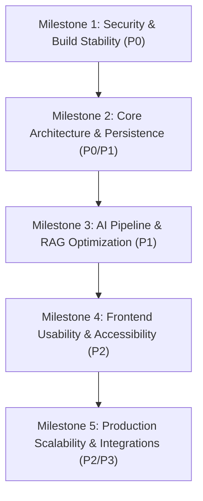

# NoticeSync — Prioritized Engineering Roadmap

**Target Repository:** [NoticeSync](https://github.com/KatkamKoushik/NoticeSync)  
**Audit Branch:** `audit/repository-review-and-roadmap`  
**Date:** October 31, 2026  

---

## 1. Prioritization Framework

All engineering initiatives are triaged using a strict impact-versus-urgency matrix:

- **P0 — Critical (Immediate Production Blockers):**  
  Security vulnerabilities, remote code execution risks, build failures, and critical data loss bugs. Must be executed prior to any deployment.
- **P1 — High Priority (Core Workflows & Reliability):**  
  Broken user workflows, persistent state failures, major AI extraction limitations, and serverless isolation flaws.
- **P2 — Medium Priority (Maintainability, UX & Architecture):**  
  Accessibility compliance, UI polish, pagination, component decoupling, and hybrid search optimization.
- **P3 — Low Priority (Product Enhancements & Advanced Integrations):**  
  External calendar OAuth sync, study roadmap forecasting, and messaging bot integrations.

---

## 2. Phased Delivery Plan

---

### Milestone 1: Security, Correctness & Build Stability
**Objective:** Eliminate critical CVEs, unblock production Next.js builds, and ensure CI/CD quality gate passes.  
**Target Window:** Days 1–2  
**Estimated Effort:** ~6 Engineering Hours  

| Task ID | Priority | Category | Action Item | Target Files |
| :--- | :---: | :--- | :--- | :--- |
| **SEC-01** | **P0** | Security | Upgrade Next.js to `>=16.4.1` to resolve Image Optimization SVG RCE. | `package.json`, `pnpm-lock.yaml` |
| **SEC-02** | **P0** | Security | Upgrade `@sentry/nextjs` to `>=10.75.2` to patch Tunnel route middleware bypass. | `package.json`, `pnpm-lock.yaml` |
| **BLD-01** | **P0** | Build / CI | Verify `pnpm audit:deps` and `pnpm build` pass with 0 security exceptions. | `.github/workflows/quality-gate.yml` |
| **SEC-04** | **P1** | Security | Enforce `Sec-Fetch-Site: same-origin` or explicit Bearer tokens to prevent cookie CSRF. | `src/lib/auth/server.ts` |

**Milestone 1 Acceptance Criteria:**
- `pnpm audit:deps` completes with 0 high or critical vulnerabilities.
- `pnpm build` compiles all static and dynamic routes cleanly with Turbopack.
- GitHub Actions CI workflow runs green on all steps.

---

### Milestone 2: Core Architecture & Data Persistence
**Objective:** Restore cross-session schedule persistence and eliminate data state disconnects.  
**Target Window:** Days 3–5  
**Estimated Effort:** ~12 Engineering Hours  

| Task ID | Priority | Category | Action Item | Target Files |
| :--- | :---: | :--- | :--- | :--- |
| **ARCH-01** | **P0** | Bug / Persistence | Create `GET /api/events` endpoint to query user-scoped `academic_events`. | `src/app/api/events/route.ts` |
| **ARCH-02** | **P0** | Bug / Frontend | Populate `confirmedEvents` on app mount via `onAuthStateChange` in `page.tsx`. | `src/app/page.tsx` |
| **ARCH-03** | **P1** | Bug / State | Reset `activeJobId` in `handleAddMore` to terminate stale background polling. | `src/app/page.tsx` |
| **UI-01** | **P1** | Bug / UX | Remove fake hardcoded fallback documents in `AcademicMemoryView`. | `src/components/academic-memory-view.tsx` |
| **SEC-05** | **P1** | Security | Disallow fallback to `supabaseServer` in user-facing endpoints to guarantee RLS enforcement. | `src/app/api/jobs/route.ts`, `src/app/api/memory/route.ts` |

**Milestone 2 Acceptance Criteria:**
- Uploaded and confirmed events persist across browser reloads, device switches, and re-logins.
- Unauthenticated memory view displays an informative prompt rather than fake documents.
- All user requests execute strictly with user-scoped RLS client.

---

### Milestone 3: AI Pipeline Quality & Performance
**Objective:** Overcome the 15,000-character syllabus truncation barrier and provide model parity in chat.  
**Target Window:** Days 6–8  
**Estimated Effort:** ~16 Engineering Hours  

| Task ID | Priority | Category | Action Item | Target Files |
| :--- | :---: | :--- | :--- | :--- |
| **AI-01** | **P1** | AI Reliability | Implement multi-chunk / map-reduce extraction for documents > 12,000 chars. | `src/app/api/parse/route.ts` |
| **AI-02** | **P1** | AI Architecture | Refactor `/api/chat/route.ts` to use provider abstraction layer instead of hardcoded Groq. | `src/app/api/chat/route.ts` |
| **RAG-01** | **P2** | RAG / Search | Upgrade hybrid retrieval to Reciprocal Rank Fusion (RRF) for balanced ranking. | `src/lib/rag/storage.ts` |
| **EVAL-01**| **P2** | Quality / Eval | Expand evaluation dataset to 25 benchmark circulars (multilingual and scanned formats). | `eval/benchmark/` |

**Milestone 3 Acceptance Criteria:**
- 25-page course syllabi have 100% of final exam and assignment dates extracted accurately.
- `LLM_PROVIDER=gemini` and `LLM_PROVIDER=ollama` work seamlessly in chat streaming.
- Benchmark eval runner verifies zero regression in precision or date accuracy.

---

### Milestone 4: Frontend Usability, Accessibility & Modern UI
**Objective:** Meet WCAG 2.1 AA accessibility standards, eliminate thread-blocking alerts, and polish UX.  
**Target Window:** Days 9–12  
**Estimated Effort:** ~14 Engineering Hours  

| Task ID | Priority | Category | Action Item | Target Files |
| :--- | :---: | :--- | :--- | :--- |
| **UI-02** | **P2** | UX / Polish | Replace synchronous `window.alert()` calls with accessible toast notifications. | `src/components/planner.tsx`, `src/app/page.tsx` |
| **UI-03** | **P2** | Bug / Timezone | Replace raw `new Date(string)` with `date-fns/parseISO` across all components. | `src/components/attention-view.tsx`, `event-card.tsx` |
| **A11Y-01**| **P2** | Accessibility | Add accessible `<label>`s to edit forms and support keyboard `Space` on drag-and-drop. | `src/components/review-event.tsx`, `omni-input.tsx` |
| **A11Y-02**| **P2** | Accessibility | Add `prefers-reduced-motion` toggle to pause or replace 4K background video. | `src/components/ai-background.tsx` |
| **PERF-01**| **P2** | Performance | Implement dynamic imports (`next/dynamic`) for `Planner`, `ReviewEvent`, and `AskNoticeSync`. | `src/app/page.tsx` |

**Milestone 4 Acceptance Criteria:**
- Automated Lighthouse / axe accessibility score >= 95.
- Zero off-by-one date shifts across PST, EST, UTC, and IST timezones.
- Initial bundle size reduced by ~35% on initial page load.

---

### Milestone 5: Scalability, Observability & Production Hardening
**Objective:** Scale ingestion across distributed serverless environments and introduce advanced calendar integrations.  
**Target Window:** Days 13–18  
**Estimated Effort:** ~20 Engineering Hours  

| Task ID | Priority | Category | Action Item | Target Files |
| :--- | :---: | :--- | :--- | :--- |
| **SEC-03** | **P1** | Security / Scale | Migrate in-memory rate limiter to Redis/Upstash sliding-window token bucket. | `src/lib/security/rateLimit.ts` |
| **DATA-01**| **P2** | Scalability | Add cursor-based pagination to `/api/memory` and `/api/events`. | `src/app/api/memory/route.ts`, `src/app/api/events/route.ts` |
| **FEAT-03**| **P2** | Architecture | Decouple heavy PDF/OCR ingestion into background worker / queue execution. | `src/app/api/parse/route.ts`, `src/lib/jobs/` |
| **FEAT-06**| **P3** | Integration | Add Google Calendar API & Microsoft Outlook OAuth one-click calendar sync. | `src/lib/calendar/google.ts`, `src/components/planner.tsx` |

**Milestone 5 Acceptance Criteria:**
- Rate limiting enforces quotas across multi-region serverless lambdas.
- Ingestion handles 50 concurrent uploads without HTTP 504 timeouts.
- Students can sync schedule directly to their university Google Calendar.
