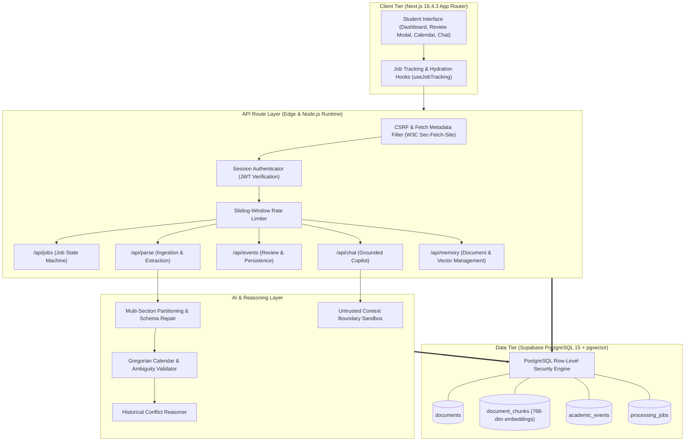
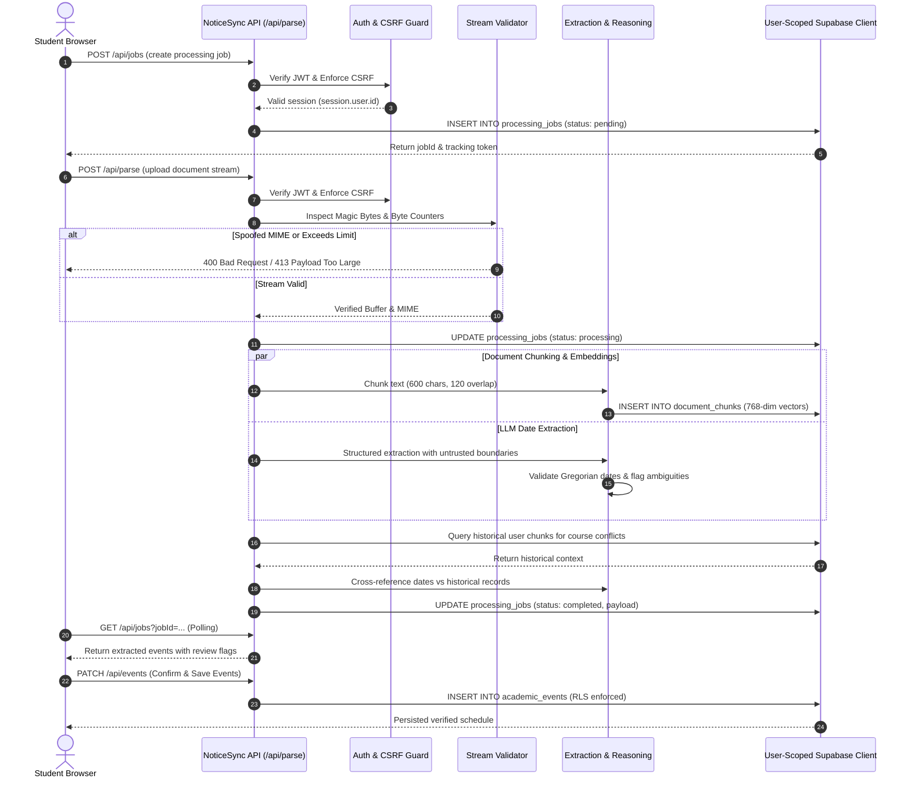
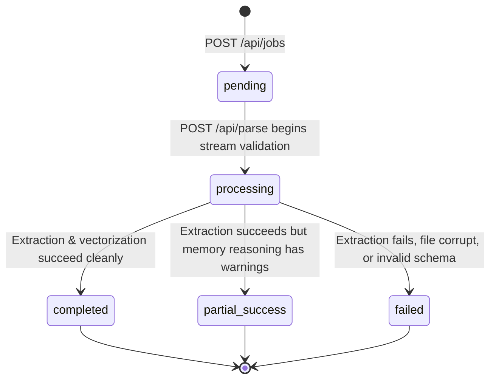
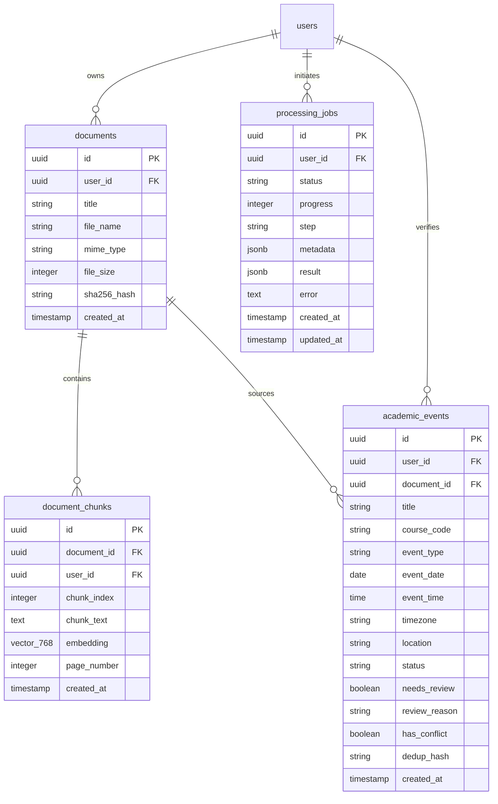

# Architecture & System Design

NoticeSync is structured around an asynchronous, decoupled pipeline designed to safely ingest heterogeneous academic documents, extract structured dates, maintain semantic vector memory, and synchronize confirmed deadlines with student planners.

---

## 1. System Topology

---

## 2. Ingestion & Job Lifecycle Sequence

The following sequence diagram details the interaction between client, server authentication, background parsing, and database persistence during a notice ingestion cycle:

---

## 3. Background Job State Machine

All asynchronous notice ingestion and extraction tasks are coordinated via the `processing_jobs` state machine:

### State Machine Transitions

| Current State | Target State | Trigger Condition | Persistence Action |
| :--- | :--- | :--- | :--- |
| `none` | `pending` | `POST /api/jobs` with valid file metadata | Inserts initial record with metadata |
| `pending` | `processing` | Ingestion stream received and validated | Updates `status: processing`, sets `progress: 10%` |
| `processing` | `completed` | All events extracted, validated, and embedded | Stores `result` JSON payload, sets `progress: 100%` |
| `processing` | `partial_success`| Events extracted but non-fatal vector/memory warnings | Stores extracted events with warning metadata |
| `processing` | `failed` | Malformed file, timeout, or fatal parser exception | Stores sanitized error message, stops processing |

---

## 4. Entity-Relationship Model

