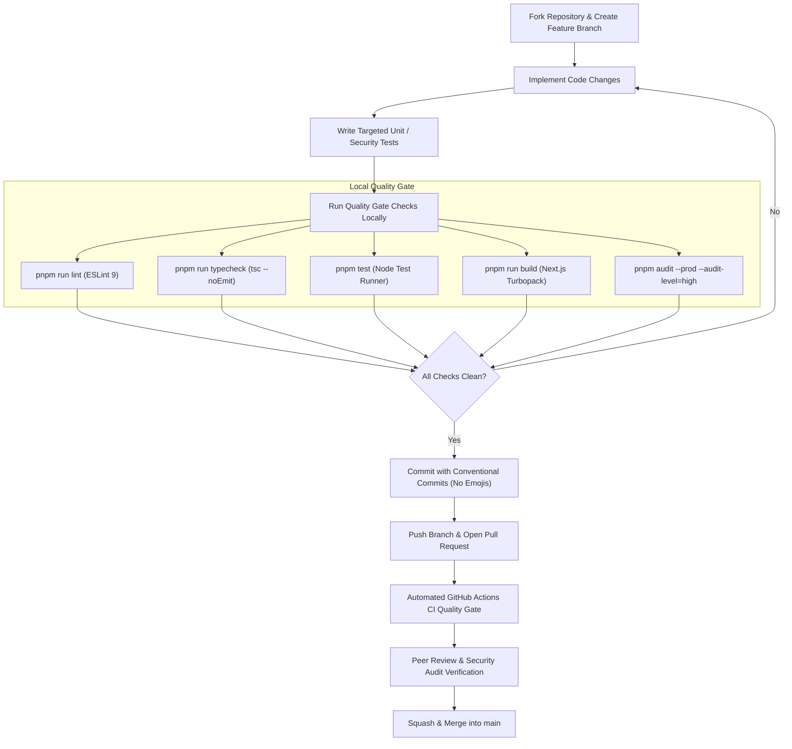

# Contributing & Community Governance

Thank you for contributing to NoticeSync. This repository adheres to high standards of code hygiene, test rigor, security isolation, accessibility, and professional technical documentation.

---

## 1. Pull Request Workflow

---

## 2. Issue and Pull Request Standards

### Issue Reporting
- **Bug Reports:** Use [Bug Report Template](../.github/ISSUE_TEMPLATE/bug_report.md). Must include reproduction steps, environment details, and non-sensitive error snippets. Do not paste real student credentials or confidential academic notices.
- **Feature Requests:** Use [Feature Request Template](../.github/ISSUE_TEMPLATE/feature_request.md). Must detail the academic use case and alternative approaches.

### Pull Request Submissions
- Use [Pull Request Template](../.github/pull_request_template.md).
- Ensure all quality gate items in the checklist are verified.
- State-changing database and API modifications must include negative cross-tenant tests.

---

## 3. Core Contribution Rules

1. **Zero-Emoji Policy:**
   All code, commit messages, documentation, test assertions, and pull requests must maintain a professional, emoji-free technical standard.

2. **Zero Privileged Fallback:**
   Never introduce fallback expressions such as `userClient || supabaseServer` or unconditional `USING(true)` policies for private tenant records.

3. **No Fabricated Dates:**
   Never convert uncertain, ambiguous, or unconfirmed dates into authoritative deadlines. Ambiguous numeric dates must be routed to human confirmation.

4. **Accessibility Compliance (WCAG 2.1 AA):**
   All interactive elements must be keyboard-accessible (`Tab`, `Enter`, `Space`, `Esc`), maintain minimum 4.5:1 color contrast ratios, respect `prefers-reduced-motion`, and provide clear ARIA attributes. Review [ACCESSIBILITY.md](../ACCESSIBILITY.md).

