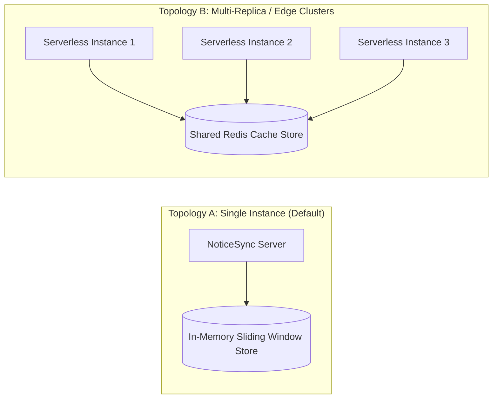

# Deployment & Operations

This guide covers operational requirements, environment configuration, database migration execution, and production deployment contracts for NoticeSync.

---

## 1. Environment Configuration

Create `.env.local` for local execution or define these variables in your hosting environment (e.g., Vercel Project Settings):

```env
# -----------------------------------------------------------------------------
# Supabase Database Configuration
# -----------------------------------------------------------------------------
NEXT_PUBLIC_SUPABASE_URL=https://your-project.supabase.co
NEXT_PUBLIC_SUPABASE_ANON_KEY=your-anon-key
SUPABASE_SERVICE_ROLE_KEY=your-service-role-key

# -----------------------------------------------------------------------------
# Pluggable AI / LLM Configuration
# Options: 'groq' | 'gemini' | 'ollama' | 'mock'
# -----------------------------------------------------------------------------
LLM_PROVIDER=groq
GROQ_MODEL=openai/gpt-oss-20b
GROQ_API_KEY_1=gsk_...
GROQ_API_KEY_2=gsk_...

# Google AI (Embeddings & Gemini Provider)
GEMINI_API_KEY=AIzaSy...
GEMMA_API_KEY=AIzaSy...

# -----------------------------------------------------------------------------
# Rate Limiting & Distributed Infrastructure
# Options: 'memory' (default single-instance) | 'shared' (distributed clusters)
# -----------------------------------------------------------------------------
RATE_LIMIT_STORAGE=memory

# -----------------------------------------------------------------------------
# Security & CSRF Trusted Deployment Hosts
# Comma-separated list of additional allowed hosts
# -----------------------------------------------------------------------------
NOTICESYNC_TRUSTED_ORIGINS=https://noticesync.app,https://staging.noticesync.app

# -----------------------------------------------------------------------------
# Test Mode (True for offline deterministic testing)
# -----------------------------------------------------------------------------
NOTICE_SYNC_TEST_MODE=false
```

---

## 2. Database Migrations Execution

NoticeSync migrations must be executed in order in your Supabase SQL Editor or via the Supabase CLI:

```bash
# Sequential Migration Order:
# 1. Base schema and pgvector extension:
supabase/migrations/20261010000000_initial_schema.sql

# 2. Row Level Security policies and least-privilege grants:
supabase/migrations/20261011000000_security_hardening.sql

# 3. Stream validation, state machine and job progress tracking:
supabase/migrations/20261012000000_ingestion_reliability.sql

# 4. Location provenance and venue attributes:
supabase/migrations/20261013000000_add_location_and_provenance.sql
```

Alternatively, apply `supabase/schema.sql` directly for a consolidated single-file bootstrap.

---

## 3. Rate Limiter Deployment Contracts

NoticeSync supports two deployment topologies:



1. **Topology A: Single-Instance Contract (`RATE_LIMIT_STORAGE=memory`):**
   Timestamp arrays are tracked in Node.js process memory. Suitable for monolithic deployments, local development, and self-hosted instances.
2. **Topology B: Distributed Contract (`RATE_LIMIT_STORAGE=shared`):**
   When scaling across multi-region serverless lambdas or Kubernetes pods, set `RATE_LIMIT_STORAGE=shared`. Rate limiting keys are persisted in centralized storage, preventing quota bypass across distributed nodes.

---

## 4. Continuous Integration Quality Gate

Every commit and pull request must satisfy the automated quality pipeline (`.github/workflows/quality-gate.yml`):

1. **Secret Scanning:** `gitleaks/gitleaks-action@v2` verifies zero private tokens or keys are present.
2. **Deterministic Installation:** `pnpm install --frozen-lockfile` validates dependencies against `pnpm-lock.yaml`.
3. **High-Severity Vulnerability Audit:** `pnpm audit --prod --audit-level=high` ensures zero high/critical vulnerabilities.
4. **Static Code Analysis:** `pnpm run lint` and `pnpm run typecheck` run ESLint and strict TypeScript compiler checks.
5. **Test Matrix:** `pnpm test` executes all 135 unit, integration, and security tests.
6. **Production Build:** `pnpm run build` verifies Next.js App Router Turbopack compilation.

