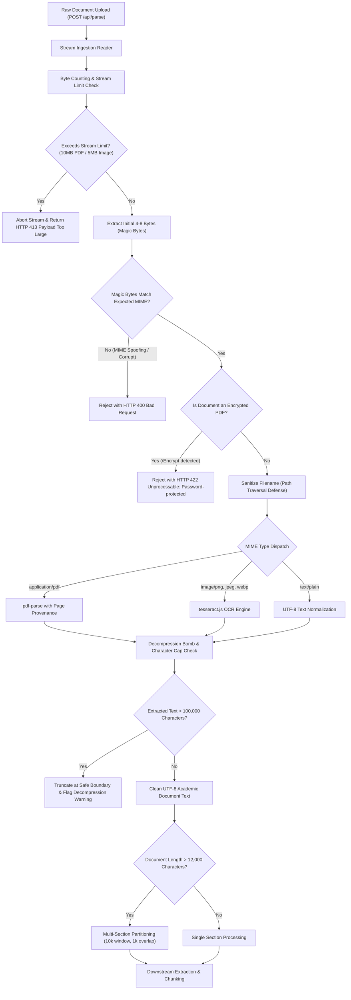

# Document Ingestion & Parser Pipeline

NoticeSync ingests unstructured university notices, course circulars, and syllabi across PDF, image, and text formats. Untrusted document ingestion is fraught with security and reliability hazards, such as MIME spoofing, oversized payload resource exhaustion, decompression bombs, and password-protected binaries.

This guide details the ingestion, sanitization, and parsing pipeline implemented in `src/lib/ingestion/streamValidation.ts` and `src/app/api/parse/route.ts`.

---

## 1. Document Ingestion Flow

---

## 2. Stream Validation & Magic-Byte Verification

HTTP `Content-Length` headers cannot be trusted because client headers can be spoofed or omitted during chunked transfer encoding. NoticeSync enforces true streaming byte counters and byte signature validation:

### Magic Byte Signatures

| File Extension | Declared MIME Type | Magic Byte Signature | Hex Representation |
| :--- | :--- | :--- | :--- |
| `.pdf` | `application/pdf` | `%PDF-` | `25 50 44 46` |
| `.png` | `image/png` | `\x89PNG\r\n\x1a\n` | `89 50 4E 47 0D 0A 1A 0A` |
| `.jpg`, `.jpeg` | `image/jpeg` | `\xFF\xD8\xFF` | `FF D8 FF` |
| `.webp` | `image/webp` | `RIFF....WEBP` | `52 49 46 46 .... 57 45 42 50` |

### Malicious Scenario Mitigations

1. **MIME Spoofing:**
   An executable or HTML script named `malicious.pdf` with header `application/pdf` is rejected immediately because its leading bytes lack the `%PDF-` signature.
2. **Encrypted PDFs:**
   PDF files containing `/Encrypt` markers are detected in the byte header and rejected with `422 Unprocessable Content`. Encrypted files cannot be extracted by the PDF parser and would otherwise cause silent parsing failures.
3. **Decompression Bombs (Zip/PDF Bombs):**
   Tiny compressed files that expand into gigabytes of whitespace or repetitive tokens are bounded at the text-extraction level by an absolute cap of **100,000 characters**.
4. **Path Traversal in Filenames:**
   Uploaded filenames containing `../`, null bytes, or dangerous directory separators are sanitized via `sanitizeFileName` (e.g., `../../etc/passwd` -> `passwd`).

---

## 3. Multi-Section Syllabi Partitioning

Academic syllabi frequently span 20–40 pages, exceeding the token budgets of small-context models and introducing middle-loss truncation where late-semester final exams are skipped.

NoticeSync mitigates this with a sliding-window text partitioner:

- **Partition Threshold:** Documents exceeding 12,000 characters.
- **Window Size:** 10,000 characters per partition.
- **Overlap:** 1,000 characters to prevent splitting exam schedules across boundary cuts.
- **Deduplication:** Events extracted across adjacent windows are unified using a deterministic SHA-256 fingerprint:
  $$\text{dedup\_hash} = \text{SHA256}(\text{course\_code} + \text{title} + \text{date} + \text{event\_type})$$

---

## 4. Parser Error Handling & Logging

NoticeSync enforces strict data hygiene on parser failures:
- **No Plausible Fabrication:** If an unreadable or corrupt notice is uploaded, the parser throws an explicit `ParsingError`. The model is never permitted to guess or fabricate plausible semester dates.
- **Temporary Storage Cleanup:** In-memory buffers and OCR scratch files are released immediately following processing.
- **No Raw Payload Logging:** Production logs redact raw extracted document contents and student credentials, recording only execution metadata (file size, SHA-256 hash, chunk count).

