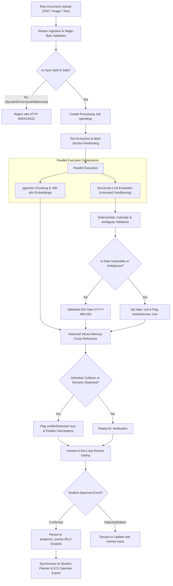

# Welcome to the NoticeSync Wiki

NoticeSync is an academic intelligence and timeline synchronization platform engineered to convert messy university circulars, exam schedules, and course syllabi into validated, synchronized student calendars.

Unlike naive document parsers that blindly trust LLM predictions, NoticeSync enforces deterministic calendar validation, cross-document historical collision detection, least-privilege tenant isolation, and mandatory human-in-the-loop gating for ambiguous dates and deadline revisions.

---

## Wiki Documentation Index

| Section | Topic | Summary |
| :--- | :--- | :--- |
| **[Architecture & Design](Architecture-and-System-Design)** | System Topology & Lifecycles | Component breakdown, async job workers, and end-to-end data pipelines |
| **[Security & Tenant Isolation](Security-and-Tenant-Isolation)** | Zero-Trust Data Isolation | Strict session auth, W3C Fetch Metadata, CSRF origin checks, and negative cross-tenant testing |
| **[Document Ingestion](Document-Ingestion-and-Parser-Pipeline)** | Ingestion & De-Bombing | Magic-byte checking, streaming byte limits, encrypted PDF defense, and multi-section partitioning |
| **[Schedule Integrity](Schedule-Integrity-and-Human-Review)** | Date & Conflict Reasoning | Gregorian verification, DST and timezone boundaries, ambiguous numeric dates, and human review gating |
| **[RAG & Vector Search](RAG-Memory-and-Vector-Search)** | Vector Memory Engine | 768-dim embeddings, pgvector cosine search, hybrid reciprocal rank fusion, and prompt isolation |
| **[API Reference](API-Reference)** | Route Authorization Matrix | Complete route-by-route HTTP specification, error codes, and request/response payloads |
| **[Deployment & Operations](Deployment-and-Operations)** | Vercel, Supabase, and CI | Production environment setup, database migrations, rate-limiting contracts, and secrets scanning |
| **[Contributing & Governance](Contributing-and-Governance)** | Community Standards | Issue forms, PR templates, code standards, zero-emoji policy, and accessibility conformance |

---

## Core Engineering Flow

The following workflow illustrates how NoticeSync safely processes untrusted academic documents into verified calendar events:

---

## Architectural Principles

1. **Never Turn Uncertain Dates into Authoritative Deadlines:**
   If a document contains ambiguous phrases ("mid next week"), impossible calendar dates (February 30), or conflicting updates from earlier circulars, the date is marked pending or ambiguous and held for manual verification.

2. **Zero Privileged Service-Role Fallback for User Operations:**
   Every API route deriving user state enforces strict authenticated sessions (`session.userClient`). The privileged `SUPABASE_SERVICE_ROLE_KEY` is completely barred from user data paths.

3. **Multi-Tenant Isolation Deny-by-Default:**
   PostgreSQL Row-Level Security (RLS) restricts access to `auth.uid() = user_id`. Client-provided `userId` parameters in JSON request bodies are discarded. Negative cross-account tests ensure zero data leakage across tenants.

4. **Defense in Depth Against Malicious Files:**
   Uploaded documents are validated using streaming byte limits, file header magic bytes, and text character quotas to neutralize decompression bombs, MIME-type spoofing, and corrupted payloads before parser execution.

5. **Safe Fallbacks & Offline Testability:**
   NoticeSync operates in zero-quota, offline test mode (`NOTICE_SYNC_TEST_MODE=true`) using deterministic mock providers for LLM extraction and vector embeddings, enabling fast CI/CD quality gates without cloud dependencies.

