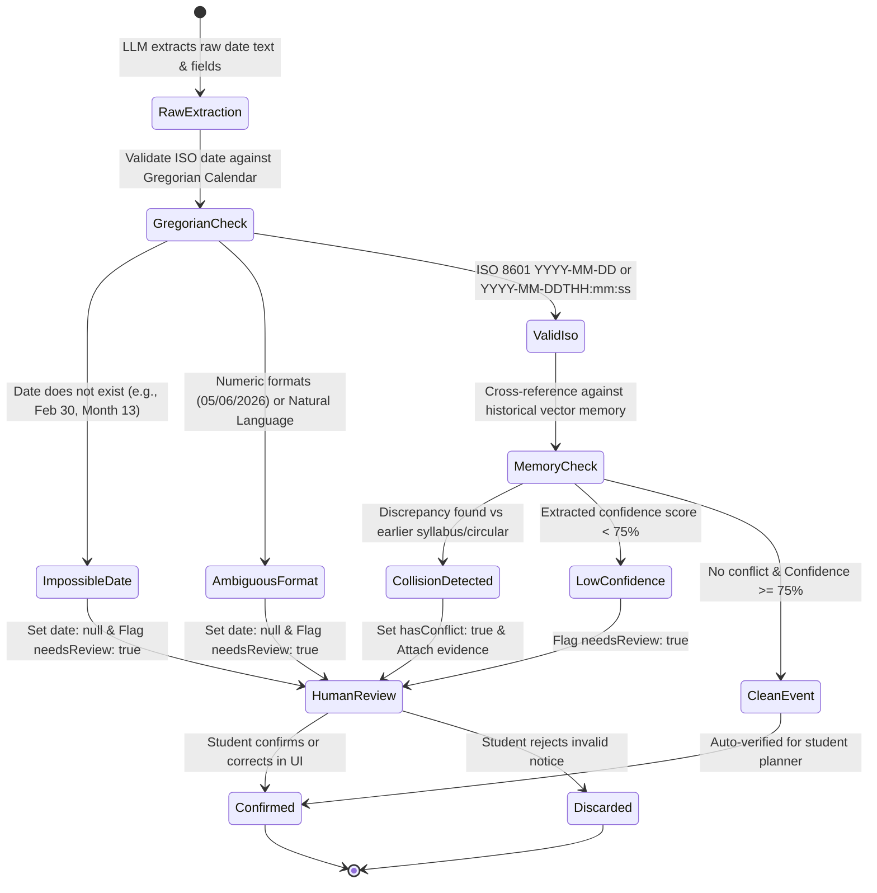

# Schedule Integrity & Human Review

In academic document and schedule processing, presenting an incorrect, fabricated, or ambiguous deadline to a student can lead to missed examinations and academic penalties. NoticeSync implements deterministic date validation, strict precision typing, timezone resilience, and human-in-the-loop review gating.

---

## 1. Schedule Verification State Machine



---

## 2. Date Precision Modeling

NoticeSync avoids treating all extracted dates as identical timestamps. Dates are categorized into explicit precision tiers via `DatePrecision`:

```typescript
export type DatePrecision = 
  | 'date_only'         // Explicit calendar day: "2026-11-15"
  | 'date_time'         // Day with specific time: "2026-11-15T14:30:00"
  | 'tentative_range'   // Multi-day window: "Mid November 2026"
  | 'null_or_pending';  // Unspecified, ambiguous, or TBA
```

### Event Provenance Tracking

Every extracted schedule record is permanently linked to its source document and location:
- `documentId`: UUID of the parent uploaded notice.
- `pageNumber`: Source page within the PDF document.
- `sourceExcerpt`: Verbatim quote from the circular.
- `confidence`: Calibrated score (0.0 to 1.0) indicating model certainty.

---

## 3. Ambiguous & Impossible Date Validation

### 1. Impossible Calendar Dates
Dates such as `2026-02-30` or `2026-04-31` are physically impossible in the Gregorian calendar. Rather than silently coercing them into adjacent months, `validateCalendarDate`:
- Detects the impossible date using strict calendar validation.
- Nullifies the date (`date = null`).
- Sets `needsReview = true` with reason `"Impossible calendar date in notice"`.

### 2. Ambiguous Numeric Formats
Formats such as `05/06/2026` cannot be reliably distinguished between US format (`May 6`) and International format (`June 5`) without locale grounding. NoticeSync flags all non-ISO numeric date patterns as ambiguous:
- Sets `date = null`.
- Sets `precision = 'null_or_pending'`.
- Sets `needsReview = true` with reason `"Ambiguous numeric date format requires student confirmation"`.

---

## 4. Timezone & Daylight Saving Time (DST) Handling

When academic notices specify examination start times (e.g., `14:30`), timezone mismatches or daylight saving transitions can corrupt schedule displays. NoticeSync enforces timezone-aware rendering via `Intl.DateTimeFormat`:

- **Explicit Timezone Tagging:** Every event records its timezone (defaulting to institutional timezone or `UTC`).
- **DST Transition Safety:** Timezone offsets are computed dynamically for the target date rather than using current local system time, preventing 1-hour shifts across DST boundaries.
- **Client Render Guarantee:** Calendar components format dates using the stored timezone rather than browser-local midnight assumptions.

---

## 5. Multi-Document Conflict Detection

When professors issue revised circulars postponing an exam from `2026-11-15` to `2026-11-22`, naive extractors simply create duplicate, conflicting calendar entries.

NoticeSync's memory reasoner (`augmentEventWithMemory`):
1. Embeds the course title and event description.
2. Queries the student's historical `document_chunks` using `pgvector`.
3. If a prior document exists for the same course with a differing date:
   - Sets `hasConflict = true`.
   - Populates `conflictType` (`rescheduled`, `extended`, `moved_earlier`, `cancelled`).
   - Links `conflictingDocumentTitle` and `conflictingDate`.
   - Requires human review before overriding the earlier schedule.

