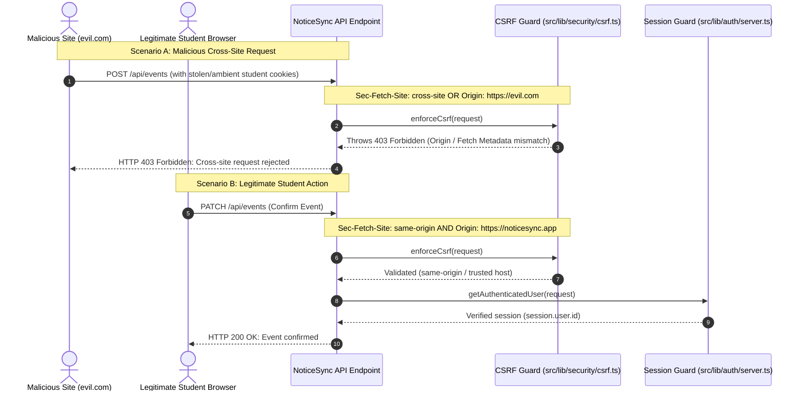

# Security & Tenant Isolation

NoticeSync is an academic-document and schedule-processing application where student records, course announcements, and personal exam schedules must remain strictly confidential and isolated. This document details the defense-in-depth security model, identity verification, cross-tenant isolation guarantees, and CSRF protection mechanisms.

---

## 1. Zero Privileged Service-Role Fallback Policy

A foundational vulnerability pattern in multi-tenant architectures is the use of `SUPABASE_SERVICE_ROLE_KEY` or fallback expressions such as `userClient || supabaseServer` when user authorization fails or is omitted. 

NoticeSync enforces a **zero privileged fallback policy**:

1. **User Routes Require User-Scoped Clients:**
   Every user-facing API route (`/api/events`, `/api/jobs`, `/api/memory`, `/api/parse`, `/api/chat`, `/api/brief`) derives user identity exclusively via `getAuthenticatedUser()`, which instantiates a user-scoped Supabase client bound strictly to the caller's JWT token.
2. **Denial in Production:**
   If a user-scoped client is missing in production, database helper methods (`storeChunk`, `retrieveRelevantChunks`, `updateJobState`) throw a `SecurityValidationError` with HTTP 403 Forbidden.
3. **No Unconditional Access:**
   The privileged `getSupabaseServerClient` is strictly reserved for administrative maintenance scripts and database migration tasks. It is banned from all runtime API handlers.

---

## 2. Web Authentication & CSRF Protection

NoticeSync supports dual authentication paths (Bearer tokens for headless CLI/integrations, and secure cookies for web browsers) while enforcing strict Origin and Fetch Metadata defenses against Cross-Site Request Forgery (CSRF).



### Protection Mechanisms

- **W3C Fetch Metadata Checks:**
  Inspects the browser-provided `Sec-Fetch-Site` header. Any state-changing request (`POST`, `PUT`, `PATCH`, `DELETE`) with `Sec-Fetch-Site: cross-site` is rejected immediately with HTTP 403 before parsing request bodies.
- **Origin & Referer Validation:**
  Validates request `Origin` and `Referer` headers against trusted production hosts (`NOTICESYNC_TRUSTED_ORIGINS`, `NEXT_PUBLIC_APP_URL`, `VERCEL_PROJECT_PRODUCTION_URL`, `VERCEL_BRANCH_URL`, or `localhost`).
- **Identity Derivation Guarantee:**
  Client-supplied `userId` fields in request bodies or query parameters are discarded. The effective identity is always derived from the verified JWT payload (`session.user.id`).

---

## 3. Negative Cross-Tenant Verification Matrix

To prevent data leakage across student accounts, NoticeSync maintains an automated negative cross-tenant test suite (`tests/security/tenant-isolation.test.ts`). Every endpoint and HTTP method is verified against adversarial cross-user requests:

| Target Endpoint | HTTP Method | Adversarial Action | System Defense | HTTP Status |
| :--- | :--- | :--- | :--- | :---: |
| `/api/events` | `GET` | User A requests academic calendar | Scoped to User A `user_id`; User B records omitted | `200 OK` (User A records only) |
| `/api/events` | `PATCH` | User A attempts to modify or confirm User B event | Checks ownership; returns 404/403 | `404 Not Found` |
| `/api/events` | `DELETE` | User A attempts to delete User B event | Checks ownership; returns 404/403 | `404 Not Found` |
| `/api/events` | `POST` | User A supplies `userId = User B` in payload | Overwrites input with `session.user.id` | `201 Created` (Bound to User A) |
| `/api/jobs` | `GET` | User A polls status of User B `jobId` | Checks ownership on `processing_jobs`; returns 404 | `404 Not Found` |
| `/api/jobs` | `POST` | User A initializes job claiming User B identity | Forces `user_id = session.user.id` | `201 Created` (Bound to User A) |
| `/api/memory` | `GET` | User A requests indexed documents | Scoped to User A `user_id`; User B docs omitted | `200 OK` (User A docs only) |
| `/api/memory` | `DELETE` | User A attempts to delete User B document ID | Checks ownership; returns 404 | `404 Not Found` |
| `/api/parse` | `POST` | User A attempts to attach parse results to User B `jobId` | Validates job ownership; rejects attachment | `404 Not Found` |
| `/api/chat` | `POST` | User A asks Copilot about User B syllabus content | Vector similarity filter enforces `p_user_id = User A` | `200 OK` (0 leakage from User B) |

---

## 4. PostgreSQL Row-Level Security (RLS)

All private tenant tables in Supabase enforce PostgreSQL Row-Level Security with deny-by-default policies:

```sql
-- Enable Row Level Security on all private tables
ALTER TABLE documents ENABLE ROW LEVEL SECURITY;
ALTER TABLE document_chunks ENABLE ROW LEVEL SECURITY;
ALTER TABLE academic_events ENABLE ROW LEVEL SECURITY;
ALTER TABLE processing_jobs ENABLE ROW LEVEL SECURITY;

-- documents: access restricted to authenticated owner
CREATE POLICY "Users can only view their own documents"
  ON documents FOR SELECT
  USING (auth.uid() = user_id);

CREATE POLICY "Users can only insert their own documents"
  ON documents FOR INSERT
  WITH CHECK (auth.uid() = user_id);

CREATE POLICY "Users can only delete their own documents"
  ON documents FOR DELETE
  USING (auth.uid() = user_id);

-- academic_events: full CRUD restricted to authenticated owner
CREATE POLICY "Users can manage their own academic events"
  ON academic_events FOR ALL
  USING (auth.uid() = user_id)
  WITH CHECK (auth.uid() = user_id);

-- vector match function: restricted to caller identity
CREATE OR REPLACE FUNCTION match_document_chunks (
  query_embedding vector(768),
  match_count int DEFAULT 5,
  p_user_id uuid DEFAULT NULL
)
RETURNS TABLE (
  id uuid,
  document_id uuid,
  chunk_text text,
  similarity float
)
LANGUAGE plpgsql
SECURITY DEFINER
AS $$
BEGIN
  RETURN QUERY
  SELECT
    dc.id,
    dc.document_id,
    dc.chunk_text,
    1 - (dc.embedding <=> query_embedding) AS similarity
  FROM document_chunks dc
  WHERE dc.user_id = p_user_id
  ORDER BY dc.embedding <=> query_embedding
  LIMIT match_count;
END;
$$;
```

---

## 5. Rate Limiting Architecture & Deployment Contract

NoticeSync enforces a pluggable sliding-window rate limiter (`src/lib/security/rateLimit.ts`):

- **Single-Instance Deployment (Default):** Uses in-memory sliding-window timestamps. Suitable for standard single-instance deployments or dev/test environments.
- **Multi-Replica Deployment:** When deploying across horizontal replicas or serverless edge clusters, configure `RATE_LIMIT_STORAGE=shared` with a centralized cache store (e.g., Upstash Redis) to prevent quota bypass across distributed nodes.

### Quota Allocations by Route

| Endpoint | Window | Allowance | Purpose |
| :--- | :---: | :---: | :--- |
| `POST /api/parse` | 60s | 10 requests | Protects CPU/memory during PDF/OCR parsing |
| `POST /api/jobs` | 60s | 30 requests | Prevents state-machine spam |
| `POST /api/chat` | 60s | 30 requests | Protects LLM token and API quotas |
| `GET, PATCH, DELETE /api/events` | 60s | 60 requests | Balances client synchronization |
| `GET, DELETE /api/memory` | 60s | 60 requests | Limits vector storage queries |
| `POST /api/brief` | 60s | 20 requests | Protects summary generation |

